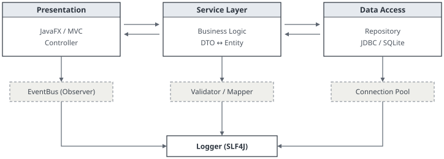

外觀：術語文件

# 專題製作規劃書（草案 v0.9）

**系統名稱**：待定　**撰寫人**：吳二弘　**文件狀態**：Draft　**最後修改**：開學前一天 03:12

**1. 系統概述**

本系統以 Java 17 為核心語言，採分層式架構（Layered Architecture），將 Presentation Layer、Service Layer 與 Data Access Layer 解耦，各層之間以 interface 定義契約，藉此提升可測試性（testability）與可維護性（maintainability）。GUI 以 JavaFX 實作，遵循 MVC 模式；事件處理採 Observer Pattern，並以 Property Binding 達成 View 與 Model 之單向資料流（unidirectional data flow）。持久層以 JDBC 存取嵌入式 SQLite，Repository 一律回傳 `Optional<T>`，以避免 NullPointerException。

**2. 系統架構圖**



**3. 開發環境與工具鏈**

建置工具採 Gradle（Kotlin DSL），相依套件經由 Maven Central 管理。版本控制使用 Git，分支策略為 Git Flow（main / develop / feature/*），所有 commit 須通過 CI pipeline 之靜態分析（Checkstyle、SpotBugs）與單元測試（JUnit 5），行覆蓋率（line coverage）目標 80% 以上。Code Review 採 Pull Request 制，至少一人 Approve 後方可 merge。

---

**4. 組員應具備之先備知識（Prerequisites）**

**4.1 程式進入點**　`public static void main(String[] args)` 為 JVM 啟動時呼叫之靜態方法，`args` 為命令列參數所構成之 `String[]`。

**4.2 標準輸出**　`System.out.println(...)` 中，`System` 為 `java.lang` 套件內之 final class，`out` 為其 `public static final PrintStream` 欄位；println 會呼叫 PrintStream 的 println 方法，將引數轉為字串後寫入標準輸出串流，並附加平台相依之行分隔符號。

**4.3 型別系統**　Java 為靜態強型別語言。基本型別（primitive type）含 `byte`、`short`、`int`、`long`、`float`、`double`、`char`、`boolean`；`String` 為參考型別（reference type），其實例為 immutable object，字串常值經 intern 後存放於 String Pool。

**4.4 控制流程**　條件分支以 `if-else` 實作，條件運算式之型別必須為 `boolean`，不得以整數代替（此點與 C 語言不同）。

**4.5 物件導向**　封裝（Encapsulation）、繼承（Inheritance）、多型（Polymorphism）、抽象（Abstraction）。interface 與 abstract class 之差異請自行參閱 JLS §8、§9。

**5. 時程規劃**

```
W01-W02  需求分析 / Use Case Diagram / ERD
W03-W06  核心模組實作 + Unit Test
W07      期中 Code Review
W08-W12  GUI 整合 / Integration Test
W13-W16  效能調校 / 文件撰寫 / Release v1.0
```

**備註**：以上皆為基礎中的基礎。
